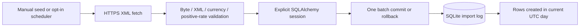

# Exchange-rate import log

A FastAPI/SQLAlchemy/SQLite prototype that imports the ECB daily XML feed, stores reference-rate samples and exposes rows imported during the current UTC day. A batch uses one transaction, and each stored `change` is the absolute difference from the previous stored sample for that currency.

This is an import-log exercise, not a live quote service or currency-conversion product. The original currency-exchange project context is retained.

## Important data semantics

The [ECB reference series](https://www.ecb.europa.eu/stats/policy_and_exchange_rates/euro_reference_exchange_rates/html/index.en.html) uses EUR as its base currency and follows a working-day publication schedule. This project currently **does not store the feed's publication date**. Its response `Date` is the UTC request/import-log day, not proof that rates were published that day.

`GET /exchange-rates/` preserves the existing daily-import contract: it can return no rows if nothing was imported today, even when older records exist. Repeated imports append samples, so multiple rows per currency can appear. `change` is neither a percentage nor guaranteed to compare adjacent publication days. A latest-provider-dated-snapshot design needs an explicit data-model/API decision.

## Run locally

Use Python 3.11+ in an isolated environment:

```sh
python3 -m venv .venv
source .venv/bin/activate
python -m pip install -r requirements.txt
uvicorn main:app --host 127.0.0.1 --port 8000
```

Schema initialization happens at application startup rather than import. SQLite defaults to `./exchange_rate.db`; `DATABASE_URL` overrides it. Import the public feed deliberately in a separate terminal:

```sh
python seeders.py
```

That command initializes the schema and makes a real network request. Verification for this review used mocked feed data instead. SQLite/runtime databases and environment files are ignored and are not bundled.

The in-process scheduler is **off by default**. To enable the existing daily import at `00:02 UTC`, set `ENABLE_SCHEDULER=true` and run only one scheduler-owning process. That schedule is not aligned to the provider's publication time; do not interpret it as a guaranteed fresh publication. Multiple API workers would each own a scheduler if enabled, so a production scheduler needs separation/coordination.

## API and import flow



`GET /` returns a process-health message. `GET /exchange-rates/` returns a `Date` field and `rates` array. An illustrative synthetic response is:

```json
{"Date":"2024-01-01","rates":[{"id":1,"currency":"USD","rate":1.2,"change":0.2}]}
```

Those are example values, not current ECB rates. The delta assumes an earlier stored sample of `1.0`. Values use floating-point storage; this is not a financial precision/transaction engine.

The fetcher uses a 15-second requests timeout, limits the XML body to 2 MiB, rejects DTD/entity declarations and validates finite positive rates. Import sessions close explicitly. A failed write rolls the whole batch back, avoiding per-currency partial imports. Same-timestamp records are ordered by ID when finding the previous sample.

## Verification and Docker

```sh
DATABASE_URL=sqlite:// ENABLE_SCHEDULER=false python -m pytest -q
# Optional local container configuration:
docker compose up --build
```

Fourteen tests pass using in-memory SQLite and mocked HTTP: API/model behavior, XML validation, absolute deltas, all-or-nothing rollback, session cleanup and lifecycle-only schema initialization with scheduling disabled. Python 3.11 and an existing newer FastAPI/SQLAlchemy verification environment were used; the exact legacy pinned environment was not recreated. A TestClient deprecation warning remains.

Compose exposes only loopback port 8000 and persists its database in a named volume. Container configuration was checked; no image/container or real scheduler/feed run was executed. There is no UI, authentication, provider-date provenance, import-batch ID, deduplication or separate worker. Resolve the snapshot-versus-log decision before adding charts or claiming current market data.
