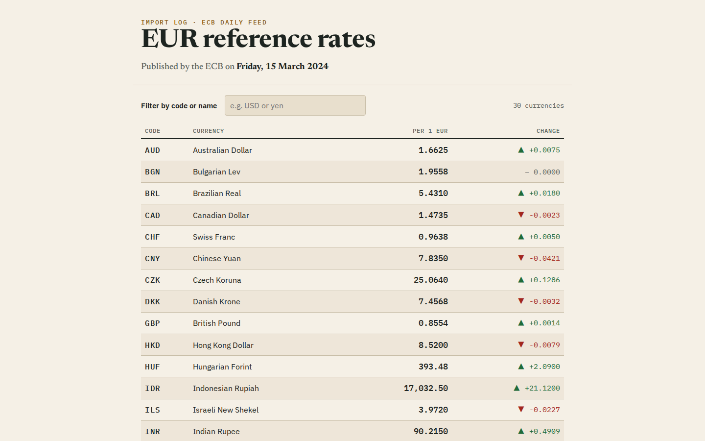
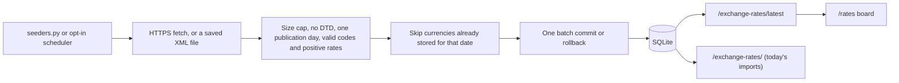
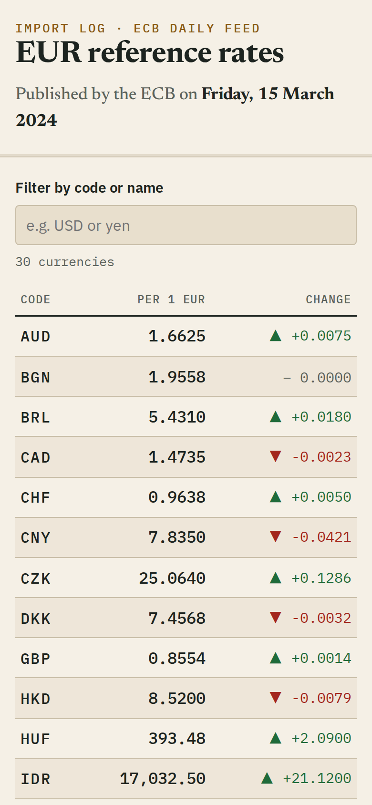
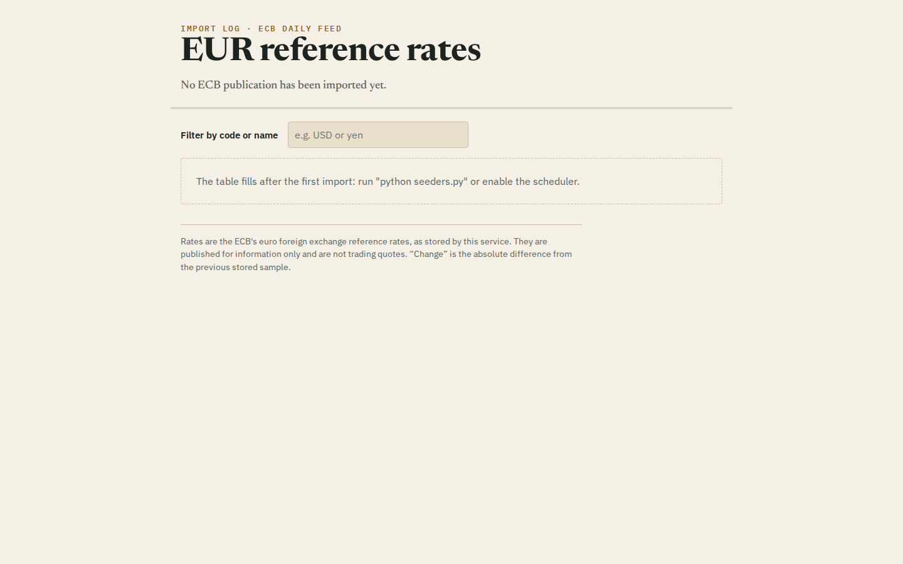

# Exchange-rate import log

A FastAPI/SQLAlchemy/SQLite prototype that imports the ECB daily euro reference-rate XML feed, stores each publication with its ECB date, and serves it as JSON and as a small rates board. Each stored `change` is the absolute difference from the previous stored sample for that currency.

This is an import-log exercise, not a live quote service or currency-conversion product. The original currency-exchange project context is retained.



## Data semantics

The [ECB reference series](https://www.ecb.europa.eu/stats/policy_and_exchange_rates/euro_reference_exchange_rates/html/index.en.html) uses EUR as its base currency and is published once per TARGET working day, around 16:00 CET. Every imported row records the feed's `Cube@time` value as `published_on`.

- `GET /exchange-rates/latest` returns every currency from the newest imported publication day. This is the snapshot view, and the rates board uses it.
- `GET /exchange-rates/` keeps the original import-log contract: rows whose `created_at` falls on the current UTC day, whatever their publication date. It can be empty even when older data exists. Its `Date` field is that UTC day, not a publication date.
- Importing a publication that is already stored adds nothing, so repeated seeding or a restarted scheduler cannot create duplicate samples. A unique `(currency, published_on)` index enforces this.
- `change` is an absolute difference (not a percentage), rounded to six decimals, against the previously *imported* sample. If publications are imported out of order, it compares against whichever was stored last.
- Rates are floats. This is not a financial precision engine.

## Run it with Docker Compose

```sh
docker compose up --build -d
# load the two bundled sample publications (synthetic data, no network needed)
docker compose exec app python seeders.py samples/eurofxref-2024-03-14.xml samples/eurofxref-2024-03-15.xml
```

Open <http://127.0.0.1:8000/rates> for the board, or <http://127.0.0.1:8000/docs> for the generated OpenAPI page. Compose binds only to loopback and keeps the database in the `exchange-rate-data` named volume; `docker compose down -v` removes it.

To import the real current feed instead, run the seeder with no arguments. That makes one HTTPS request to the ECB:

```sh
docker compose exec app python seeders.py
```

## Run it with a local Python

Python 3.13 is pinned in `.python-version`, `pyproject.toml` and the Dockerfile.

```sh
python3.13 -m venv .venv
source .venv/bin/activate
python -m pip install -r requirements-dev.txt
cp .env.example .env   # optional; the defaults below apply without it
python seeders.py samples/eurofxref-2024-03-14.xml samples/eurofxref-2024-03-15.xml
uvicorn main:app --host 127.0.0.1 --port 8000
```

The app does not read `.env` itself; export the variables or let Compose set them.

| Variable | Default | Meaning |
| --- | --- | --- |
| `DATABASE_URL` | `sqlite:///./exchange_rate.db` | SQLAlchemy URL |
| `ENABLE_SCHEDULER` | `false` | `true` starts an in-process job on weekdays at 15:30 UTC |

`requirements.txt` holds only what the app imports at runtime and is what the image installs; `requirements-dev.txt` adds pytest, flake8 and `httpx2` (Starlette's TestClient transport).

## API

Captured from the Compose stack after loading the two samples (rate lists trimmed to three entries):

```http
GET /exchange-rates/latest
```

```json
{"published_on": "2024-03-15", "rates": [
  {"id": 45, "currency": "AUD", "rate": 1.6625, "change": 0.0075, "published_on": "2024-03-15"},
  {"id": 33, "currency": "BGN", "rate": 1.9558, "change": 0.0, "published_on": "2024-03-15"},
  {"id": 46, "currency": "BRL", "rate": 5.431, "change": 0.018, "published_on": "2024-03-15"}
]}
```

Before anything is imported it returns `{"published_on": null, "rates": []}`.

```http
GET /exchange-rates/
```

```json
{"Date": "2026-11-09", "rates": [
  {"id": 15, "currency": "AUD", "rate": 1.655, "change": null, "published_on": "2024-03-14"},
  {"id": 45, "currency": "AUD", "rate": 1.6625, "change": 0.0075, "published_on": "2024-03-15"}
]}
```

Both samples were imported that UTC day, so this endpoint lists all 60 rows. `GET /` returns `{"message": "System is up and running"}`, and `GET /rates` serves the board.

## Import flow



## Design notes

- **Fetch limits.** The fetcher uses a 15-second timeout, streams at most 2 MiB, refuses DTD and entity declarations, and reports malformed XML, a missing rate or a bad date as `ValueError`.
- **One transaction per import.** A failed write rolls the whole batch back, so there are no per-currency partial imports.
- **Scheduler timing.** The ECB publishes around 16:00 CET (15:00 UTC in winter, 14:00 UTC in summer), so the optional job runs Monday to Friday at 15:30 UTC. TARGET holidays are not modelled; on those days the feed still shows the previous publication and the import is a no-op. Enable the scheduler in one process only, because each API worker would otherwise run its own copy.
- **Schema changes without a migration tool.** `ensure_schema()` runs at startup and in the seeder. It creates missing tables and adds the nullable `published_on` column, with its indexes, to databases created before that column existed. Older rows keep `NULL` and never show up in `/latest`.
- **The board is static files.** `static/rates.html`, `rates.css` and `rates.js` are served by FastAPI and need no build step. The page fetches `/exchange-rates/latest`, labels currencies with `Intl.DisplayNames`, filters by code or name, and has loading, empty and error states. Narrow screens drop the name column.

| Phone width | Before the first import |
| --- | --- |
|  |  |

## Tests and lint

```sh
python -m pytest
flake8
```

The 36 tests run against in-memory SQLite with mocked HTTP or the bundled sample files, so they need no network. They cover the API, the models, XML validation and limits, publication-date storage and idempotent re-imports, the column upgrade on an older database, the rounded deltas, all-or-nothing rollback, session cleanup, the scheduler's fire time, seeding from files, and serving the board.

## Limitations

There is no authentication, no import-batch ID, no historical backfill (the 90-day and full-history ECB feeds are rejected because they contain several publication days), and no separate worker process. The bundled samples are synthetic and only shaped like the ECB feed.

## License

MIT, see [LICENSE](LICENSE).
